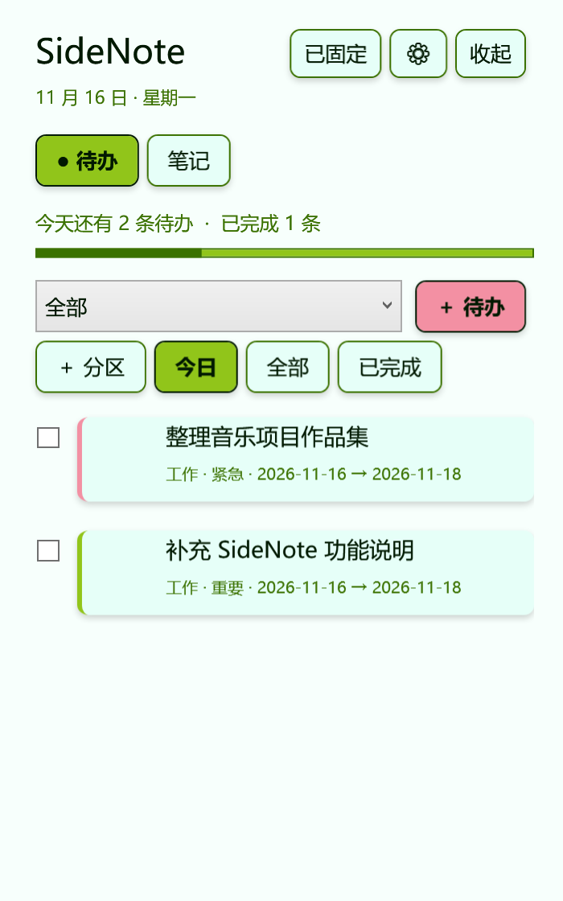
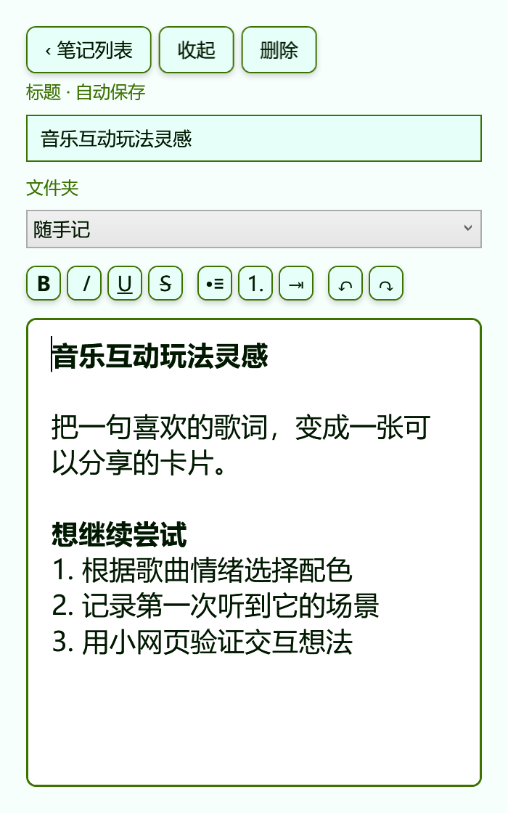

# SideNote · 桌面便签待办

将待办和随手记放在桌面右侧，需要时展开，记录后收起。

一直想找一款合心意的待办与便签应用，试过许多仍不满意，于是决定自己做一个。还在持续完善中。

## 下载体验

**适用于 Windows 10 / 11。**

- [下载最新版 SideNote（ZIP 免安装版）](https://github.com/Sienna0905/sticky-to-do/releases/latest/download/SideNote-Windows.zip)
- [查看版本说明和其他下载文件](https://github.com/Sienna0905/sticky-to-do/releases/latest)

下载后先完整解压，再双击 `SideNote.exe`。无需安装 Node.js 或 Electron。

首次启动后，鼠标靠近主屏幕右侧中段即可展开面板。点击「固定」可以让它保持显示；右键系统托盘图标可退出。

## 界面预览

 

截图中的待办和笔记为演示数据，下载包不附带个人记录。

## 主要功能

- 待办支持分区、优先级、日期区间和定时提醒；未完成事项可以连续显示在「今日」。
- 笔记支持富文本和文件夹整理，标题及正文自动保存到本地。
- 面板支持触边展开、离开收起、固定显示和调整大小；可设置透明度、字体及开机启动。

详细行为见[功能说明](docs/功能说明.md)。
## 本地编译

使用 Windows 自带的 .NET Framework / WPF：

```powershell
powershell -ExecutionPolicy Bypass -File build.ps1
```

生成 `SideNote.exe`。运行 `SideNote.exe --self-test` 可验证日期过滤、完成状态、中文保存及备份恢复；结果写入 `test-result.txt`。

GitHub Actions 在推送 `v*` 标签后编译、运行自检，并发布免安装 ZIP 包。
